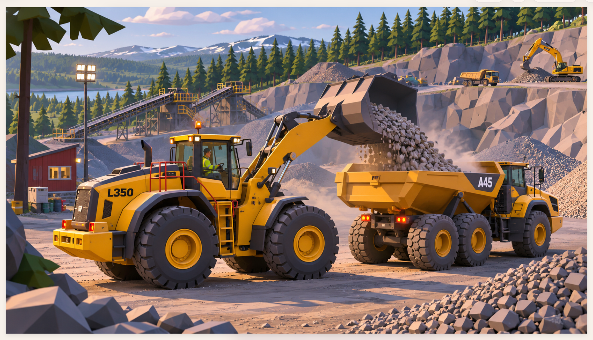

# DIRT WORK — ART DIRECTION
Status: approved visual target (concept reference supplied by project owner, 2026-11-11).

## North star
**Premium stylized industrial realism**: convincingly proportioned, mechanically detailed construction machines inside a deliberately faceted, low-poly Nordic quarry. Not farming, not toy-like, not generic primitive blockout, not photorealism.

The approved concept shows a yellow articulated wheel loader tipping gravel into an articulated hauler, with terraced rock faces, conveyors, pines, distant mountains, atmospheric dust and warm late-afternoon lighting. Treat the image as *art direction*, not exact geometry or guaranteed real-time fidelity. **Approved reference image:** \n\nSource file: [`docs/image.png`](image.png). This is the primary visual target for the DW-90 and quarry environment; compare actual Godot captures against it.

## Visual hierarchy
1. **Hero machinery — highest detail:** believable silhouettes and scale, wide earthmover tires with deep tread and recessed rims, articulated chassis, proper bucket thickness/profile, functional lift/linkage geometry, cylinders and hoses, cab framing, glazing, handrails, steps, lamps, vents and counterweights.
2. **Industrial site — medium detail:** conveyor systems, crusher, floodlights, safety rails, cabins, haul roads and working terraces. Props must imply a plausible quarry workflow.
3. **Landscape — stylized low-poly:** large faceted rock planes with coherent fracture direction, angular rubble, clustered conifers, readable silhouettes, mountains and a distant lake. Avoid arbitrary floating rocks, noisy uniform pebble scatter and featureless flat floors.
4. **Atmosphere:** warm sun, cool sky fill, grounded contact shadows, restrained dust, subtle haze and varied roughness. Lighting must remain readable in gameplay, not just screenshots.

## Materials and palette
- Machinery: warm construction yellow, charcoal undercarriage, black rubber, worn steel, reflective but restrained glass, red safety rails and amber beacons.
- Quarry: warm beige earth, cool slate/gray rock, desaturated green conifers, blue distance.
- Prefer distinct roughness/metallic responses and restrained wear to uniformly saturated flat colors.
- No manufacturer marks or copied logos. In-game fictional DW-90 branding is fine.

## Camera and composition
- Reference review: three-quarter front/side angle with both loader and material target in frame; medium-low camera, natural perspective, recognizable scale.
- Also review: exact side silhouette, front, rear, raised/lowered bucket, cab view, daytime gameplay camera.
- Avoid judging model quality from one orthographic side view alone.

## Asset production
- Current source of truth for DW-90 geometry: `tools/blender/build_wheel_loader.py`.
- Current scene assembly source: `tools/gen_wheel_loader.py`; do not hand-edit generated `scenes/vehicles/wheel_loader.tscn` without updating its generator.
- Preserve wheel, arm, bucket and chassis pivot origins, named node paths, collision, input and gameplay behavior.
- Author assets with Blender headless, export glTF/GLB, import into Godot. Prefer iterative improvements to wholesale rebuilds.
- Do not conflate hero asset detail with terrain polygon density.

## Render and review loop (mandatory for visual changes)
1. Record what changed and the visual objective.
2. Regenerate only affected assets; run `tests/check.sh` and headless Godot import.
3. Capture actual in-engine review shots with `tools/capture_shots.gd` on a GPU/display or Xvfb-capable host; check whether the selected renderer supports the intended effects.
4. Inspect the **actual screenshots** side-by-side with the approved concept. Identify three biggest gaps in silhouette, material response, lighting, environment composition.
5. Fix the biggest gap first; repeat. Do not assert a visual match based on source code or headless tests.
6. Preserve a before/after screenshot and note limitations in the PR.

## Acceptance criteria — DW-90 visual pass
- Side/front/three-quarter silhouette immediately reads as a heavy articulated wheel loader, not a toy.
- Tire width, wheelbase, cab/hood, boom and bucket proportions look mechanically credible.
- Lift/tilt articulation works across full travel without obvious interpenetration or detached geometry.
- Different materials are distinguishable in daylight and golden-hour light.
- Hero shot has a clear working quarry context, depth, purposeful props and readable gravel loading.
- Gameplay view remains legible, controllable and performant on the target Mac.
- No gameplay regressions; headless tests pass, and visual review is explicitly recorded.

## Explicit non-goals for the next iteration
No new vehicles, economy overhaul, weather simulation, multiplayer, terrain destruction or cinematic trailer until the DW-90 and one small quarry showcase area meet the above visual criteria.

## Next task for Claude Code
Read this file, `CLAUDE.md`, `docs/ROADMAP.md`, `tools/blender/build_wheel_loader.py`, `tools/gen_wheel_loader.py` and `scripts/world/quarry_world.gd`. Produce a gap analysis using actual screenshots. Then implement a **single focused visual improvement** without modifying gameplay physics, and provide before/after renders and test results.
